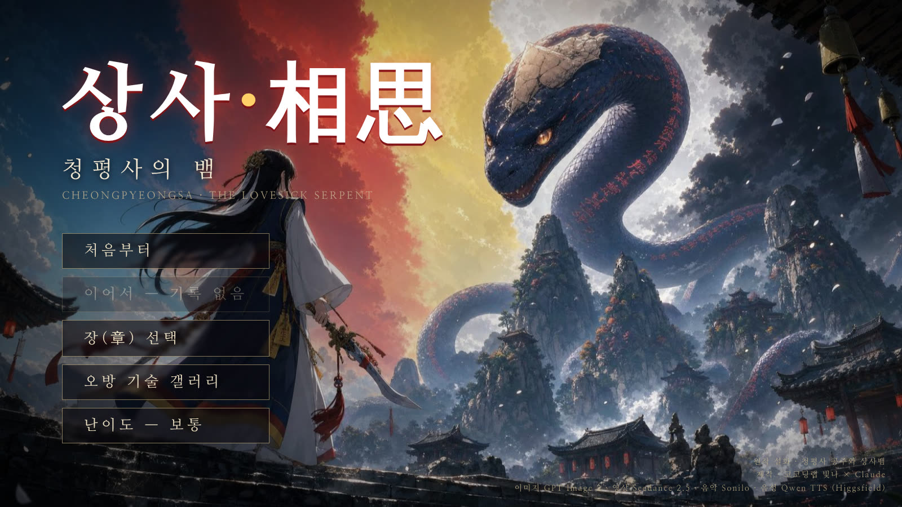
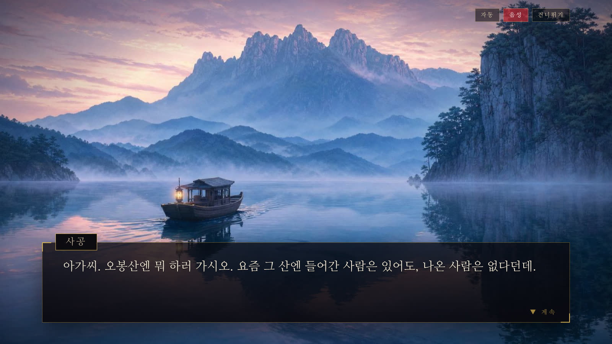
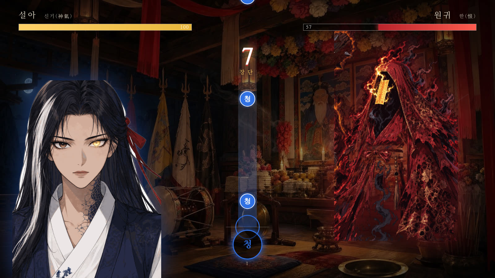
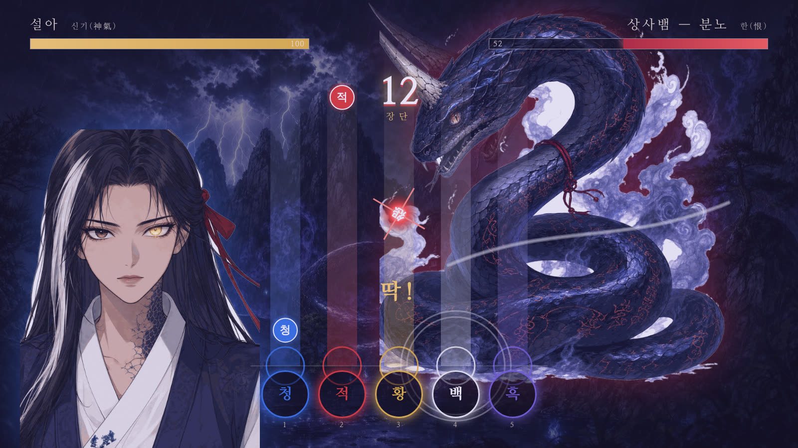
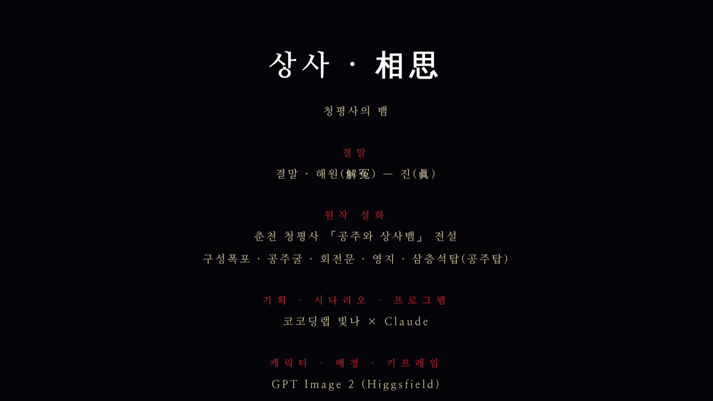

# 상사(相思): 청평사의 뱀 · Sangsa: The Serpent of Cheongpyeongsa

**▶ Play in browser / 플레이:** https://binna0728.github.io/sangsa/  ·  itch.io: https://binna0728.itch.io/sangsa

---

## English

**A Korean shamanic rhythm-action visual novel — play it in your browser.**

Based on a real legend from Cheongpyeongsa Temple in Chuncheon, Korea: a princess who crossed the sea from the Yuan court, and the lovesick serpent that coiled around her neck and would not let go.

### Story
A court official who could never speak his love died of longing — and his *han* (unresolved grief) hardened into a serpent. A thousand years later it finds the princess again. Diagnosed with the "spirit sickness," she is taken in by the old shaman of Mt. Obong and trained in the five-direction rite. To free herself she must climb the mountain — past the drowned ghost of the Nine-Sound Waterfall and the goblin who guards the Revolving Gate — and face the serpent at the Shadow Pond.

The legend ends with a lightning bolt. This game lets you choose a different ending: call down the lightning, or perform the *ssitgim-gut* and call him by the name no one ever spoke while he lived.

### Gameplay
- **Five-direction rhythm battles** — shake the shaman flags in time with the *janggu* drum. Blue, red, yellow, white, black: each direction is a technique, and matching the beat purifies the spirit instead of destroying it.
- **Four spirits to face** — the wraith in the ritual hall, the water ghost of the waterfall, the wrestling goblin at the gate, and the serpent itself (two phases).
- **Fully voiced visual novel** in Korean with animated portraits, cinematic cutscenes, and a branching ending.
- **Three difficulty levels**, chapter select, and a technique gallery.
- Runs in any modern browser on PC or mobile (landscape). No install.

### Controls
Keys **1–5** (or D F G H J) hit the five lanes; **Space** parries the red *grudge* notes. On mobile, tap the lane buttons.

*Language: Korean (voice & text). English UI/subtitles are planned.*

| | |
|---|---|
|  |  |
|  |  |

---

## 한국어

춘천 청평사 「공주와 상사뱀」 설화를 바탕으로 한 한국 무속 판타지 리듬 노벨.

### 조작
- 대화 진행: 클릭 / Space / Enter
- 전투: 숫자 1~5 (또는 D F G H J), 화면의 원 클릭
- 붉은 `怨` 구슬은 아무 키나 눌러 막기
- 장단 10연속마다 오방 기술 발동
- 모바일: 가로 화면에서 원을 탭

### 구성
5장 · 오방굿 리듬 전투 · 2가지 결말(벼락 / 씻김굿) · 난이도 3단계

### 제작
기획·시나리오·프로그램 — 코코딩랩 빛나 × Claude
이미지 GPT Image 2 · 영상 Seedance · 음악 Sonilo · 음성 Qwen Audio TTS (Higgsfield)

원작 설화: 청평사 구성폭포 · 공주굴 · 회전문 · 영지 · 삼층석탑(공주탑)
